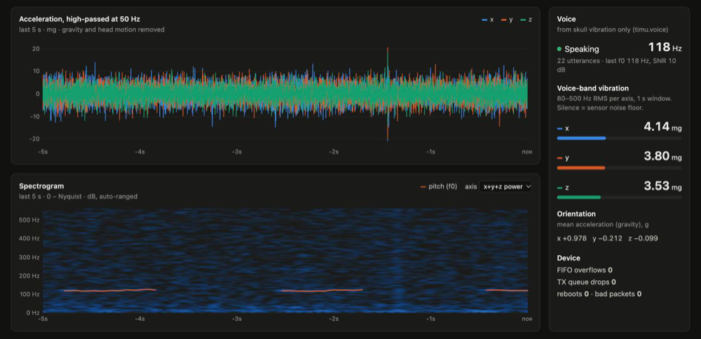
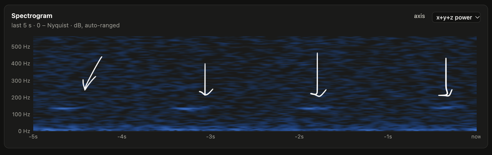
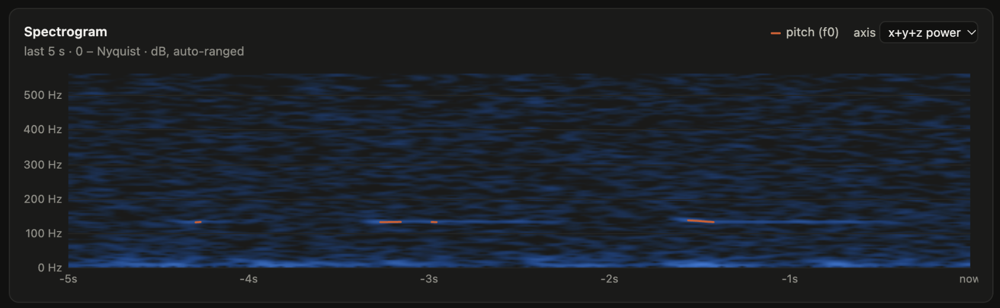
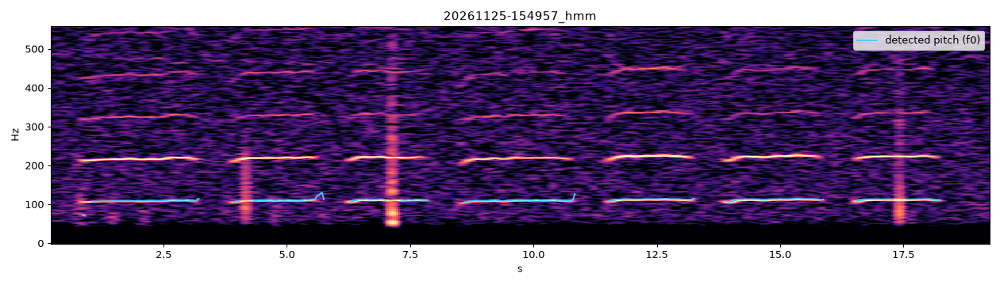

# temple-imu-speech

Picking up your own voice as **skull vibration**: an ICM-20948 accelerometer pressed against the
temple, streamed by an ESP32 over WiFi to a PC that shows it live, records it, and detects when the
wearer is speaking and at what pitch. Other people's voices and room noise don't reach the sensor —
only the wearer's own bone-conducted speech does.



*Live dashboard during three long "hellooo"s. The **orange lines** are the detected pitch (f0 ≈ 118 Hz)
drawn over the spectrogram; the sidebar shows the speaking state, current pitch, per-axis
voice-band vibration and link health. (Captured by replaying a real recording through the hub.)*

## What the sensor sees

Each spoken "hello" shows up as a thin horizontal line at the voice's fundamental frequency — here
about 130–140 Hz, with the small rise and fall of the word:



Held "hellooo"s give longer lines, which the detector follows for their whole length:



*(This screenshot is from before the sustain fix described below: the detector only caught the
start of each word. It now tracks the full line, as in the dashboard image at the top.)*

On 2026-11-25 (cause not yet pinned down: placement, contact pressure or speaking level) the harmonics appeared clearly. Seven held "hmm"s
show a stack of lines at ~110, 220, 330, 440 and 550 Hz (f0 and its 2nd–5th harmonics); the blue
line is the detected pitch:



*The full-height stripes (~4.1, 7.1 and 17.4 s) are knocks; today they split those hmms into two
detected segments.*

What we've learned so far:

| | |
|---|---|
| **Pitch (f0)** | Clearly visible: 10–14 dB above the sensor noise in its frequency bin. |
| **Harmonics** | Depend on how the sensor sits. On 2026-11-24 they were weak (2nd +3–6 dB, 3rd at the noise floor); on 2026-11-25 the 2nd–5th were clearly visible, the 2nd often stronger than f0. |
| **Sensor noise** | ~140 µg/√Hz measured (datasheet 230), i.e. ~3.5 mg RMS per axis in 80–500 Hz. This is the limiting factor; contact pressure is the cheapest lever. |
| **Link** | ~1135 Hz true sample rate, 0 samples lost over WiFi in all recordings so far. |

## How it works

```
 ICM-20948 ──SPI──► ESP32 ──WiFi/UDP──► hub (Python) ──► recordings/*.timu
 (temple)          FIFO @ ~1.1 kHz       timu.hub      ──► web dashboard   http://localhost:8765
                                         + voice       ──► Python clients  ws://localhost:8765/ws
                                           detector
```

- **Firmware** (`firmware/`, ESP-IDF v6): reads accel + gyro from the sensor's hardware FIFO, so the
  sample timing comes from the sensor, not from software. One core reads the sensor every 2 ms; the
  other handles WiFi, with ~2.7 s of buffering in between for WiFi hiccups. The sensor and WiFi both
  recover on their own after faults.
- **UDP packets**: 32 samples + a 48-byte header. A running sample counter lets the PC count lost
  samples exactly; separate fields mark device-side gaps and reboots.
- **Hub** (`host/timu/hub.py`): the only process that talks to the device. It records, runs the
  voice detector, and forwards everything over WebSocket to the dashboard and to any number of
  Python clients.
- **Recordings** store the packets byte-for-byte, so nothing is lost if formats change later.

### Voice detector (`host/timu/voice.py`)

Every ~28 ms it looks at the last ~225 ms of all three axes and asks whether there is a **narrow
pitch line between 70 and 350 Hz** standing out from an adaptive noise estimate:

- **To start voicing**, the line must be ≥ 9 dB above the noise, sharply peaked, at most ~9 Hz wide
  and ≥ 6 dB above the surrounding ±50 Hz. Voice is a pure, narrow tone; chewing and nodding make
  broad, smeared bumps.
- **To keep voicing**, only the area around the current pitch is checked, with a lower bar (5 dB),
  because voicing weakens after the start of a word.
- **Taps and cable knocks** are rejected by their sudden sample-to-sample jumps, far bigger than
  bone-conducted voice ever produces.
- **Pitch** is the strongest line, unless half, a third or a quarter of its frequency is also a peak
  above the noise: then that is the real pitch and the strongest line was a harmonic.
- The noise estimate ignores anything that looks like voice, so long utterances don't teach it to
  treat the voice as noise.

Results on the recordings collected so far (one speaker, two sessions):

| Recording | What it contains | Result |
|---|---|---|
| `hello` | 5 short "hello"s, sensor at temple | **5 / 5** detected, f0 130–136 Hz |
| `long_hello` | 5 held "hellooo"s, 0.7–1.3 s each | **5 / 5**, tracked for their full length, f0 ~119 Hz |
| `negatives` | chewing, nodding, re-placing the sensor; no speech | **2** short false alarms (was 25 before the line-shape test) |
| `bench_check` | sensor still, no speech | **0** false alarms |
| `long_sentence` | "hello this is me speaking" ×3, then two long hellos | 18 segments; f0 95–114 Hz (read an octave high, ~210 Hz, before the harmonic check) |
| `hmm` | 7 held "hmm"s, 1.5–2.5 s each | f0 108–113 Hz throughout; **11** segments, since knocks split 3 hmms, plus 1 short false start |

This is a small test set; thresholds will be revisited as more varied data comes in.

## Hardware

ESP32 DevKit (classic ESP32) + 7Semi ICM-20948 breakout, SPI:

| ESP32 pin | IMU board pin     | Function          |
|-----------|-------------------|-------------------|
| 3V3       | VCC / VIN         | power (3.3 V)     |
| GND       | GND               | ground            |
| GPIO 18   | SCL / SCLK        | SPI clock         |
| GPIO 23   | SDA / SDI         | SPI MOSI          |
| GPIO 19   | AD0 / SDO         | SPI MISO          |
| GPIO 5    | CS / NCS          | chip select       |
| —         | INT, FSYNC, AUX_* | leave unconnected |

- Power from **3V3, not 5V**. The ICM-20948 core is 1.8 V; the breakout must have its own regulator
  and level shifting.
- I2C fallback (fewer wires, no future high-rate mode): set `IMU_BUS IMU_BUS_I2C` in
  `firmware/main/config.h`; wire SDA→GPIO 21, SCL→GPIO 22, CS→3V3.
- Keep the cable ≤ 30 cm, thin and flexible, with strain relief so cable tugs don't shake the
  sensor. If you see bit errors, lower `IMU_SPI_HZ`.

**Mounting:** flat on bare skin over bone, just above or in front of the ear, **pressed firmly** with
a headband or strap; tape alone is weak. Keep the ESP32 off the head (collar or pocket). In our
placement the x axis picked up the voice best (14.6 dB vs ~8.5 dB for y and z).

## Running it

### Firmware (ESP-IDF v6)

```sh
cp firmware/main/secrets.example.h firmware/main/secrets.h   # then fill in WiFi name + password
cd firmware
. $IDF_PATH/export.sh
idf.py build flash monitor -p /dev/cu.usbserial-0001
```

The **ESP32 only supports 2.4 GHz WiFi.** The serial log prints a status line every 2 s: sensor
rate, FIFO overflows, TX queue drops, WiFi signal and the connected PC.

### Host

```sh
cd host
uv run python -m timu.hub                     # then open http://localhost:8765
uv run python -m timu.hub --record bench      # start recording immediately
uv run python -m timu.hub --bind 0.0.0.0      # allow other machines on the LAN (they can also record)
```

The hub finds the ESP32 automatically (broadcast); pass `--host <ip>` to skip discovery. Start and
stop labeled recordings from the dashboard's Record button.

Python processing clients connect to the hub (run as many as you like alongside the dashboard):

```python
from timu.client import stream
for pkt in stream():                  # timu.protocol.Packet, exactly as the device sent it
    process(pkt.first_sample, pkt.accel_g(), pkt.gyro_dps())
```

`async for pkt in timu.client.packets(): ...` is the asyncio version. Voice results arrive on the same
WebSocket as `{"type":"voice","frames":[[sample, voiced, f0_hz|null, snr_db], ...]}`.

Recordings:

```python
from timu.recording import load
r = load("recordings/20261124-232010_long_hello.timu")
r.accel_g, r.gyro_dps, r.sample_index, r.segment, r.rate_hz
```

```sh
uv run python -m timu.voice recordings/*.timu    # run the voice detector over recordings
uv run --with matplotlib --with scipy python -m timu.plot recordings/*.timu
                                                 # spectrogram + detected pitch -> <recording>.png
```

## Protocol

`firmware/main/protocol.h` ⇔ `host/timu/protocol.py` (keep in sync; bump the version on change).
48-byte header + int16 frames (ax ay az gx gy gz). `first_sample` makes lost samples exactly
countable; `segment` marks device-side gaps of unknown length; `boot_id` marks reboots.

## Roadmap

1. ~~Stream: ~1.1 kHz, zero loss, live dashboard~~ ✓
2. ~~Voice activity + pitch tracking from vibration alone~~ ✓ (needs a larger, more varied test set)
3. **Realistic test**: talking mixed with chewing, nodding and walking; tune thresholds on it.
4. **Synchronized dataset**: microphone audio alongside the IMU, for labels and for using the IMU as a
   "wearer is speaking" trigger next to a mic.
5. **More signal**: better mounting pressure; higher-bandwidth mode (accel ~4.5 kHz); a lower-noise
   vibration sensor (e.g. ST IIS3DWB) or a bone-conduction voice pickup if harmonics stay weak.
6. **Models**: keyword/command recognition and IMU-assisted speech enhancement.
